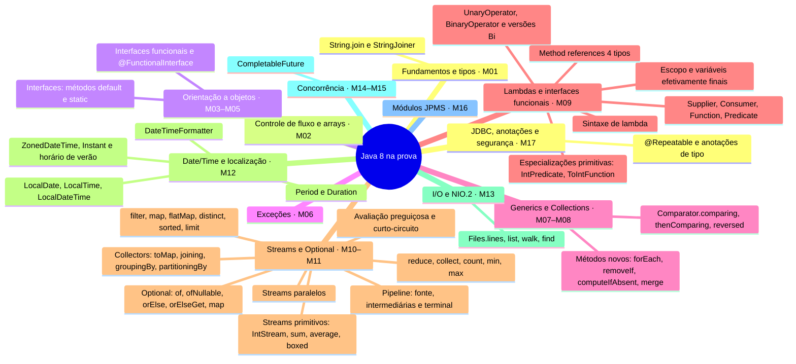

# Mapa mental: Java na prova (base Java 8)

Mapa dos assuntos cobrados na **1Z0-819 (Java SE 11 Developer)**, com o **Java 8** como base. Cada tópico traz a versão do Java em que apareceu, o módulo da trilha que o cobre e uma **pergunta-guia**. As perguntas não têm resposta aqui de propósito: se você não sabe respondê-la com segurança, esse é o tópico a estudar.

> Versão interativa (filtro por versão do Java e progresso salvo no navegador): abra [`mapa-mental.html`](mapa-mental.html) no navegador.

**12 ramos · 101 tópicos · 26 introduzidos no Java 8.**

**Legenda das versões:** `≤7` já existia antes do Java 8 · **`8`** novidade do Java 8 · `9`, `10`, `11` novidades posteriores, cobradas na 1Z0-819.

## Visão geral: os 12 ramos e as novidades do Java 8

O diagrama mostra só o que o Java 8 trouxe em cada ramo. A lista completa, com os tópicos de todas as versões, está em "Ramos em detalhe".

## O que o Java 8 trouxe para a prova

| Novidade | Ramo do mapa |
|---|---|
| `String.join` e `StringJoiner` | Fundamentos e tipos |
| Interfaces: métodos `default` e `static` | Orientação a objetos |
| Interfaces funcionais e `@FunctionalInterface` | Orientação a objetos |
| Métodos novos: `forEach`, `removeIf`, `computeIfAbsent`, `merge` | Generics e Collections |
| `Comparator.comparing`, `thenComparing`, `reversed` | Generics e Collections |
| Sintaxe de lambda | Lambdas e interfaces funcionais |
| Escopo e variáveis efetivamente finais | Lambdas e interfaces funcionais |
| `Supplier`, `Consumer`, `Function`, `Predicate` | Lambdas e interfaces funcionais |
| `UnaryOperator`, `BinaryOperator` e versões `Bi` | Lambdas e interfaces funcionais |
| Especializações primitivas: `IntPredicate`, `ToIntFunction`... | Lambdas e interfaces funcionais |
| Method references (4 tipos) | Lambdas e interfaces funcionais |
| Pipeline: fonte, intermediárias e terminal | Streams e Optional |
| Avaliação preguiçosa e curto-circuito | Streams e Optional |
| `filter`, `map`, `flatMap`, `distinct`, `sorted`, `limit` | Streams e Optional |
| `reduce`, `collect`, `count`, `min`, `max` | Streams e Optional |
| Collectors: `toMap`, `joining`, `groupingBy`, `partitioningBy` | Streams e Optional |
| Streams primitivos: `IntStream`, `sum`, `average`, `boxed` | Streams e Optional |
| Streams paralelos | Streams e Optional |
| Optional: `of`, `ofNullable`, `orElse`, `orElseGet`, `map` | Streams e Optional |
| `LocalDate`, `LocalTime`, `LocalDateTime` | Date/Time e localização |
| `ZonedDateTime`, `Instant` e horário de verão | Date/Time e localização |
| `Period` e `Duration` | Date/Time e localização |
| `DateTimeFormatter` | Date/Time e localização |
| `Files.lines`, `list`, `walk`, `find` | I/O e NIO.2 |
| `CompletableFuture` | Concorrência |
| `@Repeatable` e anotações de tipo | JDBC, anotações e segurança |

## Ramos em detalhe

Marque `[x]` quando conseguir responder à pergunta-guia **sem consultar nada**.

### Fundamentos e tipos

Módulo **M01** · semana 1 do [cronograma](CRONOGRAMA.md)

- [ ] Estrutura da classe, `main`, pacotes e imports · `≤7`  
  ❓ Que tipo de import vence quando dois imports curinga trazem classes de mesmo nome?
- [ ] Literais e identificadores · `≤7`  
  ❓ Em que posições o `_` é proibido dentro de um literal numérico?
- [ ] Primitivos, promoção numérica e casting · `≤7`  
  ❓ Qual é o tipo do resultado de `byte + byte`?
- [ ] Operadores, precedência e ordem de avaliação · `≤7`  
  ❓ Precedência e ordem de avaliação são a mesma coisa?
- [ ] Wrappers, autoboxing e cache · `≤7`  
  ❓ Quando `==` entre dois `Integer` dá `true`?
- [ ] String: imutabilidade, pool e API · `≤7`  
  ❓ Quando duas Strings concatenadas apontam para o mesmo objeto?
- [ ] StringBuilder · `≤7`  
  ❓ `StringBuilder` sobrescreve `equals`?
- [ ] `String.join` e `StringJoiner` · `8`  
  ❓ Como montar `[a, b, c]` com prefixo e sufixo sem laço manual?
- [ ] `var`: inferência de tipo local · `10`  
  ❓ Em quais lugares `var` é proibido?
- [ ] `var` em parâmetros de lambda · `11`  
  ❓ Dá para misturar `var` e tipo explícito nos parâmetros de uma lambda?
- [ ] `strip`, `isBlank`, `lines`, `repeat` · `11`  
  ❓ Qual é a diferença documentada entre `trim` e `strip`?
- [ ] Execução de arquivo-fonte único · `11`  
  ❓ Ao rodar `java Arquivo.java`, qual classe é executada?

### Controle de fluxo e arrays

Módulo **M02** · semana 2 do [cronograma](CRONOGRAMA.md)

- [ ] `if`/`else` e operador ternário · `≤7`  
  ❓ Qual é o tipo de um ternário com operandos `int` e `Integer`?
- [ ] `switch` clássico e fall-through · `≤7`  
  ❓ Quais tipos o `switch` aceita no Java 11?
- [ ] Laços: `for`, for-each, `while`, `do-while` · `≤7`  
  ❓ O corpo de um `do-while` com condição falsa executa?
- [ ] Labels, `break` e `continue` · `≤7`  
  ❓ Para onde salta um `continue` com label?
- [ ] Código inalcançável · `≤7`  
  ❓ `while (false) {...}` e `if (false) {...}` compilam?
- [ ] Arrays e arrays multidimensionais · `≤7`  
  ❓ O que `int[] a, b[];` declara?
- [ ] `Arrays.sort`, `binarySearch`, `asList` · `≤7`  
  ❓ O que `binarySearch` devolve num array não ordenado?
- [ ] `Arrays.compare` e `mismatch` · `9`  
  ❓ Qual é a diferença entre `equals`, `compare` e `mismatch`?

### Orientação a objetos

Módulo **M03–M05** · semana 3–5 do [cronograma](CRONOGRAMA.md)

- [ ] Construtores e ordem de inicialização · `≤7`  
  ❓ Em que ordem rodam blocos estáticos, blocos de instância e construtores?
- [ ] `static`, escopo e passagem por valor · `≤7`  
  ❓ Java passa objetos por referência?
- [ ] Encapsulamento e imutabilidade · `≤7`  
  ❓ O que falta para uma classe com campos `final` ser imutável?
- [ ] Ciclo de vida e garbage collection · `≤7`  
  ❓ Quando um objeto fica elegível para coleta?
- [ ] Sobrescrita, sobrecarga e ocultação · `≤7`  
  ❓ Métodos estáticos são sobrescritos ou ocultados?
- [ ] Classes abstratas, polimorfismo e casting · `≤7`  
  ❓ Quando um cast compila, mas lança `ClassCastException`?
- [ ] Interfaces: métodos `default` e `static` · `8`  
  ❓ O que acontece quando duas interfaces têm o mesmo método `default`?
- [ ] Interfaces funcionais e `@FunctionalInterface` · `8`  
  ❓ Um método `default` conta para a regra do método abstrato único?
- [ ] Interfaces: métodos `private` · `9`  
  ❓ Para que servem métodos `private` numa interface?
- [ ] Enums com construtor, campos e métodos · `≤7`  
  ❓ Um enum pode ter construtor público?
- [ ] Classes aninhadas: interna, estática, local, anônima · `≤7`  
  ❓ Uma classe local pode usar variável local que não é efetivamente final?
- [ ] `equals`, `hashCode` e `toString` · `≤7`  
  ❓ O que quebra ao sobrescrever `equals` sem `hashCode`?

### Exceções

Módulo **M06** · semana 6 do [cronograma](CRONOGRAMA.md)

- [ ] Hierarquia: checked, unchecked e `Error` · `≤7`  
  ❓ Uma `RuntimeException` precisa ser declarada no `throws`?
- [ ] `try`/`catch`/`finally` · `≤7`  
  ❓ Um `return` no `finally` faz o quê com uma exceção pendente?
- [ ] Multi-catch · `≤7`  
  ❓ `catch (IOException | Exception e)` compila?
- [ ] Try-with-resources e `AutoCloseable` · `≤7`  
  ❓ Em que ordem os recursos são fechados?
- [ ] Recurso efetivamente final no `try` · `9`  
  ❓ Dá para usar no `try (...)` uma variável declarada antes dele?
- [ ] Exceções suprimidas · `≤7`  
  ❓ Onde vai parar a exceção lançada pelo `close()`?
- [ ] Exceções customizadas e sobrescrita · `≤7`  
  ❓ Um método sobrescrito pode lançar uma checked mais ampla?

### Generics e Collections

Módulo **M07–M08** · semana 7–8 do [cronograma](CRONOGRAMA.md)

- [ ] Classes e métodos genéricos, operador diamante · `≤7`  
  ❓ Onde se declara o parâmetro de tipo de um método genérico?
- [ ] Curingas: `? extends` e `? super` · `≤7`  
  ❓ Dá para adicionar um `Integer` em `List<? extends Number>`?
- [ ] Type erasure · `≤7`  
  ❓ `new T()` compila? Por quê?
- [ ] `List`, `Set`, `Map`, `Queue`, `Deque` · `≤7`  
  ❓ Quais implementações não aceitam `null`?
- [ ] Métodos novos: `forEach`, `removeIf`, `computeIfAbsent`, `merge` · `8`  
  ❓ O que `merge` faz quando a função devolve `null`?
- [ ] `Comparable` e `Comparator` · `≤7`  
  ❓ Qual dos dois a própria classe implementa?
- [ ] `Comparator.comparing`, `thenComparing`, `reversed` · `8`  
  ❓ Em que trecho da cadeia o `reversed()` age?
- [ ] `List.of`, `Set.of`, `Map.of` · `9`  
  ❓ O que acontece ao chamar `add` numa lista criada com `List.of`?
- [ ] `copyOf` e `toUnmodifiableList` · `10`  
  ❓ `List.copyOf` sempre cria uma cópia?

### Lambdas e interfaces funcionais

Módulo **M09** · semana 9 do [cronograma](CRONOGRAMA.md)

- [ ] Sintaxe de lambda · `8`  
  ❓ Quando parênteses, chaves e `return` são opcionais?
- [ ] Escopo e variáveis efetivamente finais · `8`  
  ❓ Uma lambda pode alterar uma variável local do método?
- [ ] `Supplier`, `Consumer`, `Function`, `Predicate` · `8`  
  ❓ Qual delas tem `andThen` e qual tem `negate`?
- [ ] `UnaryOperator`, `BinaryOperator` e versões `Bi` · `8`  
  ❓ Qual é a relação entre `UnaryOperator` e `Function`?
- [ ] Especializações primitivas: `IntPredicate`, `ToIntFunction`... · `8`  
  ❓ Qual interface recebe `int` e devolve `boolean`?
- [ ] Method references (4 tipos) · `8`  
  ❓ Como `String::length` vira uma `Function<String, Integer>`?
- [ ] `Predicate.not` · `11`  
  ❓ Que problema de method reference o `Predicate.not` resolve?

### Streams e Optional

Módulo **M10–M11** · semana 10–11 do [cronograma](CRONOGRAMA.md)

- [ ] Pipeline: fonte, intermediárias e terminal · `8`  
  ❓ O que acontece num pipeline sem operação terminal?
- [ ] Avaliação preguiçosa e curto-circuito · `8`  
  ❓ Quantas vezes um `peek` imprime antes de um `findFirst`?
- [ ] `filter`, `map`, `flatMap`, `distinct`, `sorted`, `limit` · `8`  
  ❓ Qual é a diferença entre `map` e `flatMap`?
- [ ] `reduce`, `collect`, `count`, `min`, `max` · `8`  
  ❓ Que tipo `reduce` devolve com e sem valor identidade?
- [ ] Collectors: `toMap`, `joining`, `groupingBy`, `partitioningBy` · `8`  
  ❓ O que `toMap` faz com chaves duplicadas?
- [ ] Streams primitivos: `IntStream`, `sum`, `average`, `boxed` · `8`  
  ❓ Que tipo `IntStream.average()` devolve, e por quê?
- [ ] Streams paralelos · `8`  
  ❓ `forEach` num stream paralelo garante a ordem?
- [ ] Optional: `of`, `ofNullable`, `orElse`, `orElseGet`, `map` · `8`  
  ❓ Qual é a diferença entre `orElse` e `orElseGet`?
- [ ] `takeWhile`, `dropWhile`, `iterate` com predicado, `ofNullable` · `9`  
  ❓ `takeWhile` num stream não ordenado é determinístico?
- [ ] `Collectors.filtering` e `flatMapping` · `9`  
  ❓ Por que filtrar dentro do `groupingBy` muda o resultado?
- [ ] Optional: `ifPresentOrElse`, `or`, `stream` · `9`  
  ❓ O que `Optional.stream()` permite num pipeline?
- [ ] `Optional.orElseThrow()` sem argumento (10) e `isEmpty` (11) · `11`  
  ❓ Qual é a diferença entre `get()` e `orElseThrow()` sem argumento?

### Date/Time e localização

Módulo **M12** · semana 12 do [cronograma](CRONOGRAMA.md)

- [ ] `LocalDate`, `LocalTime`, `LocalDateTime` · `8`  
  ❓ Esses objetos são mutáveis?
- [ ] `ZonedDateTime`, `Instant` e horário de verão · `8`  
  ❓ Quantas horas tem o dia em que começa o horário de verão?
- [ ] `Period` e `Duration` · `8`  
  ❓ Qual dos dois aceita `LocalDate`?
- [ ] `DateTimeFormatter` · `8`  
  ❓ Qual é a diferença entre `MM` e `mm` num padrão?
- [ ] `Locale` e `ResourceBundle` · `≤7`  
  ❓ Em que ordem os bundles são procurados?
- [ ] `NumberFormat` e `MessageFormat` · `≤7`  
  ❓ Como formatar moeda de outro país sem mudar o `Locale` padrão?

### I/O e NIO.2

Módulo **M13** · semana 13 do [cronograma](CRONOGRAMA.md)

- [ ] `java.io`: bytes, caracteres e decorators · `≤7`  
  ❓ Qual é a diferença entre `InputStream` e `Reader`?
- [ ] `Console` · `≤7`  
  ❓ `System.console()` pode devolver `null`?
- [ ] Serialização e `transient` · `≤7`  
  ❓ Qual construtor roda na desserialização?
- [ ] `Path` e `Files` · `≤7`  
  ❓ `Path` representa um arquivo que já existe?
- [ ] `Files.lines`, `list`, `walk`, `find` · `8`  
  ❓ O stream de `Files.walk` precisa ser fechado?
- [ ] `Files.readString`, `writeString`, `Path.of` · `11`  
  ❓ Qual é a diferença entre `Path.of` e `Paths.get`?

### Concorrência

Módulo **M14–M15** · semana 14–15 do [cronograma](CRONOGRAMA.md)

- [ ] `Thread`, `Runnable`, `Callable` · `≤7`  
  ❓ Qual dos dois pode lançar checked exception e devolver valor?
- [ ] `ExecutorService`, `Future`, `shutdown` · `≤7`  
  ❓ O que acontece se esquecer o `shutdown`?
- [ ] `synchronized`, `volatile` e atômicos · `≤7`  
  ❓ `volatile` torna `i++` seguro?
- [ ] Locks: `ReentrantLock`, `ReadWriteLock` · `≤7`  
  ❓ `tryLock()` bloqueia a thread?
- [ ] Coleções concorrentes e `CopyOnWrite` · `≤7`  
  ❓ Quando `CopyOnWriteArrayList` é uma boa escolha?
- [ ] `CyclicBarrier` e `CountDownLatch` · `≤7`  
  ❓ Qual dos dois pode ser reutilizado?
- [ ] `CompletableFuture` · `8`  
  ❓ Em que thread roda um `thenApply`?
- [ ] Deadlock, livelock, starvation e race condition · `≤7`  
  ❓ Como diferenciar livelock de deadlock?

### Módulos (JPMS)

Módulo **M16** · semana 16 do [cronograma](CRONOGRAMA.md)

- [ ] `module-info`: `requires`, `exports`, `opens` · `9`  
  ❓ Qual é a diferença entre `exports` e `opens`?
- [ ] `requires transitive` e `requires static` · `9`  
  ❓ Quem enxerga um módulo lido com `requires transitive`?
- [ ] Serviços: `uses` e `provides` · `9`  
  ❓ Quem chama o `ServiceLoader`: quem usa ou quem provê?
- [ ] Módulos nomeados, automáticos e sem nome · `9`  
  ❓ Um módulo nomeado pode ler o módulo sem nome?
- [ ] Migração top-down e bottom-up · `9`  
  ❓ Em qual estratégia os JARs viram módulos automáticos primeiro?
- [ ] `jdeps`, `jlink`, `jmod` · `9`  
  ❓ Qual ferramenta encontra dependências de APIs internas do JDK?

### JDBC, anotações e segurança

Módulo **M17** · semana 17 do [cronograma](CRONOGRAMA.md)

- [ ] `DriverManager`, `Connection` e URL JDBC · `≤7`  
  ❓ Quais são as partes de uma URL JDBC?
- [ ] `PreparedStatement` e `CallableStatement` · `≤7`  
  ❓ Como o `PreparedStatement` ajuda contra SQL injection?
- [ ] `ResultSet` e transações · `≤7`  
  ❓ Em que índice começa a contagem de colunas do `ResultSet`?
- [ ] Criar anotações: `@Retention` e `@Target` · `≤7`  
  ❓ Quais são os tipos permitidos nos elementos de uma anotação?
- [ ] `@Repeatable` e anotações de tipo · `8`  
  ❓ O que é preciso declarar para repetir uma anotação?
- [ ] Anotações padrão: `@Override`, `@Deprecated`, `@SafeVarargs`... · `≤7`  
  ❓ Em que métodos `@SafeVarargs` é permitido?
- [ ] Secure coding: validação de entrada, injeção e DoS · `≤7`  
  ❓ Lista de permitidos ou lista de proibidos: qual é mais segura?
- [ ] Dados sensíveis, imutabilidade e serialização segura · `≤7`  
  ❓ Que informação nunca deve aparecer numa mensagem de exceção?

---

*Este arquivo e o `mapa-mental.html` são gerados a partir da mesma lista de tópicos. Ao alterar um, altere o outro.*
